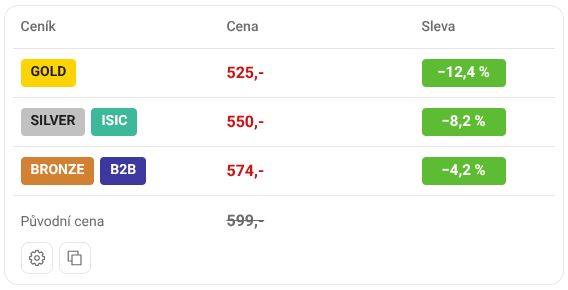

# Alza Benefit Prices

Userscript pro **Alza.cz** (včetně mobilní verze m.alza.cz), který přímo na stránce produktu přehledně zobrazí ceny benefitních a firemních ceníků (**Gold**, **Silver**, **ISIC**, **Bronze**, **B2B** a **Basic**) včetně procentuálních slev a akčních nabídek.

Jedná se o fork [původního projektu](https://github.com/dexnis-dev/Alza-Benefit-Prices), který vznikl jako odlehčená varianta s drobnými vylepšeními a úpravami přesně podle mých potřeb.

## 📸 Ukázka

## 🚀 Hlavní funkce

* **Zobrazení benefitních ceníků:** Okamžitý přehled cen pro ceníky Gold, Silver, ISIC, Bronze, B2B a referenční Basic přímo u detailu produktu.
* **Kalkulace slev:** Automatický výpočet a zobrazení reálné úspory a procentuální slevy oproti standardní ceně.
* **Podpora akcí a benefitů:** Zohlednění akčních nabídek jako AlzaPlus+, Cashback či Výkup a výběr nejvýhodnější kombinace.
* **Rychlé kopírování nabídky:** Tlačítko pro zkopírování kompletního přehledu slev včetně odkazu na produkt ve formátu připraveném k odeslání do chatu nebo e-mailu.
* **Přizpůsobitelné zobrazení:** Možnost zapnutí/vypnutí jednotlivých ceníků, trvalé zobrazení i bez slev nebo přesunutí panelu pod galerii fotografií.
* **Affiliate integrace:** Možnost automatického přidání partnerského ID (`?idp=...`) do kopírovaného odkazu.
* **Mobilní podpora:** Plná funkčnost na desktopovém webu i mobilním rozhraní `m.alza.cz`.

## 🛠 Technologie

* **Jazyk:** JavaScript (ES6+)
* **Prostředí:** Userscript (Violentmonkey, Tampermonkey, Userscripts pro Safari)
* **Integrace:** Oficiální API `webapi.alza.cz` (prostřednictvím `GM_xmlhttpRequest`)
* **Ukládání nastavení:** Userscript Storage API (`GM_getValue` / `GM_setValue`)

## ⚙️ Instalace

[👉 Nainstalovat Alza Benefit Prices](https://github.com/FejbyK/Alza-Benefit-Prices/raw/refs/heads/main/alza-benefit-prices.user.js)

### Chromium a Firefox

1. **Instalace správce userscriptů:**
   * Doporučujeme **Violentmonkey**:
     * [Chrome, Opera, Brave a další Chromium prohlížeče](https://chromewebstore.google.com/detail/violentmonkey/jinjaccalgkegednnccohejagnlnfdag)
     * [Microsoft Edge](https://microsoftedge.microsoft.com/addons/detail/violentmonkey/eeagobfjdenkkddmbclomhiblgggliao)
     * [Firefox](https://addons.mozilla.org/firefox/addon/violentmonkey/)
2. **Povolení uživatelských skriptů (Chromium):**
   * V prohlížečích založených na Chromiu otevřete správu rozšíření (např. `chrome://extensions` nebo `edge://extensions`).
   * Najděte **Violentmonkey**, otevřete **Podrobnosti** a zapněte volbu **Povolit uživatelské skripty** (pokud je v prohlížeči vyžadována).
3. **Přidání skriptu:**
   * Klikněte na instalační odkaz výše a potvrďte instalaci ve Violentmonkey.
4. **Použití:**
   * Otevřete nebo obnovte jakoukoli stránku produktu na [Alza.cz](https://www.alza.cz/).

### Safari (macOS / iOS)

1. Nainstalujte rozšíření [Userscripts z App Store](https://apps.apple.com/cz/app/userscripts/id1463298887?l=cs).
2. Povolte rozšíření Userscripts v nastavení Safari a udělte oprávnění pro přístup k `alza.cz` a `webapi.alza.cz`.
3. Otevřete instalační odkaz výše, klikněte na ikonu Userscripts a potvrďte přidání skriptu (nebo vložte kód skriptu ručně).
4. Obnovte stránku produktu na Alze.

## 🔧 Možnosti nastavení

Kliknutím na ikonu ozubeného kola v panelu můžete upravit:

* **Ceníky:** Zapnutí nebo vypnutí zobrazení konkrétních cenových úrovní.
* **Akce:** Samostatné zapnutí/vypnutí akcí AlzaPlus+, Cashback a Výkup.
* **Zobrazení:**
  * **Vždy zobrazit ceníky:** Zobrazí přehled i v případě, že u produktu není žádná sleva nebo mají všechny ceníky stejnou cenu.
  * **Přesunout ceník doleva:** Na počítači přesune panel pod miniatury galerie.
* **Affiliate:** Zadejte své partnerské číslo (`?idp=číslo`), které se automaticky připojí k odkazu při kopírování.

Veškeré nastavení se automaticky ukládá do úložiště prohlížeče.

## 📋 Kopírování nabídky

Tlačítko vedle ozubeného kola zkopíruje nabídku do schránky pro snadné sdílení:

* Zkopíruje název produktu, běžnou cenu, zlevněné ceníky a přímý odkaz.
* Ceníky se shodnou cenou automaticky sloučí (např. `SILVER/ISIC`).
* Ceníky s různými akcemi přehledně rozdělí do jednotlivých bloků.

## 👤 Původní autor

Původním autorem tohoto skriptu je [Dexnis](https://github.com/dexnis-dev).
